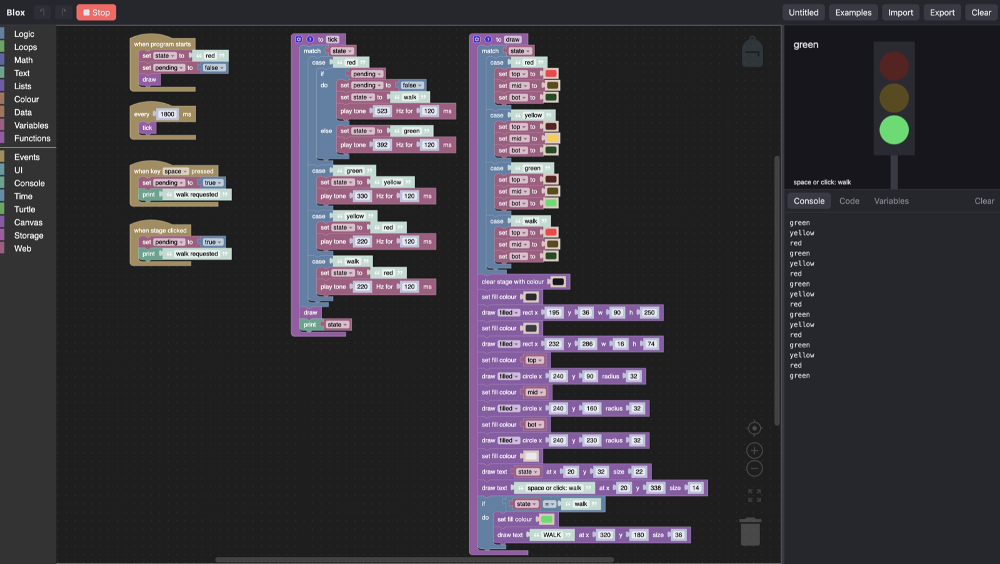
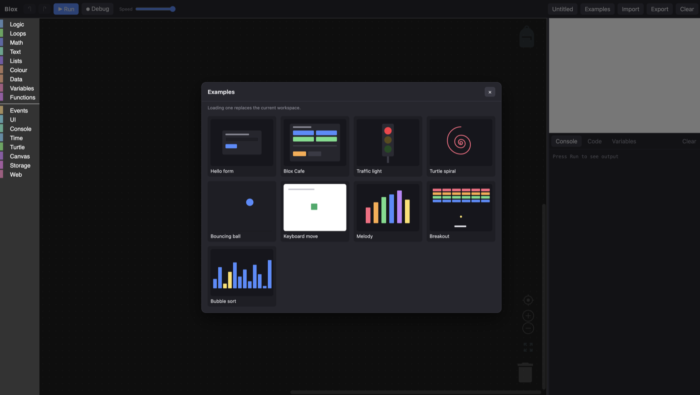

# Blox

Snap blocks. Hit Run. They execute on a 4:3 stage.

<p align="center">
  
</p>

A browser IDE: Blockly stacks compile to JavaScript and run in a worker — canvas, turtle, or a UI overlay in the same box.

## Run

```sh
pnpm i
pnpm dev
```

Node 22+.

Workers Builds (Cloudflare dashboard): build `pnpm --filter @blox/web build`, deploy `npx wrangler deploy`, root `/`.

<p align="center">
  
</p>

## Layout

- `apps/web` — IDE
- `packages/blocks` — blocks + JS codegen
- `packages/editor` — Blockly workspace
- `packages/runtime` — worker, stage, UI overlay

## Examples

**Examples** in the toolbar. Traffic light is a state machine (`match` / `case`). Cafe is a multi-screen form. Breakout and bubble sort use the canvas.
